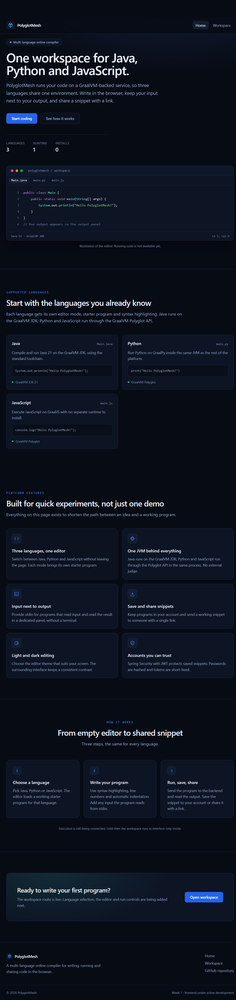
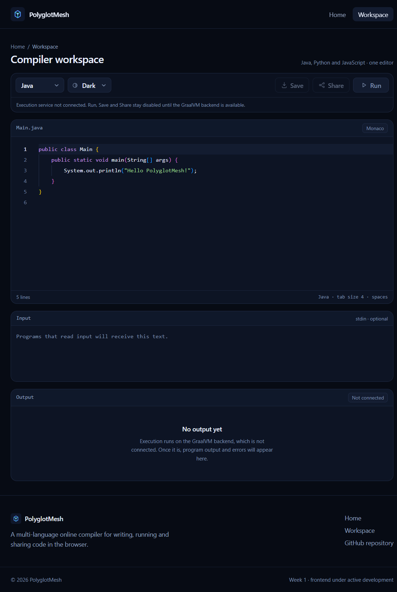
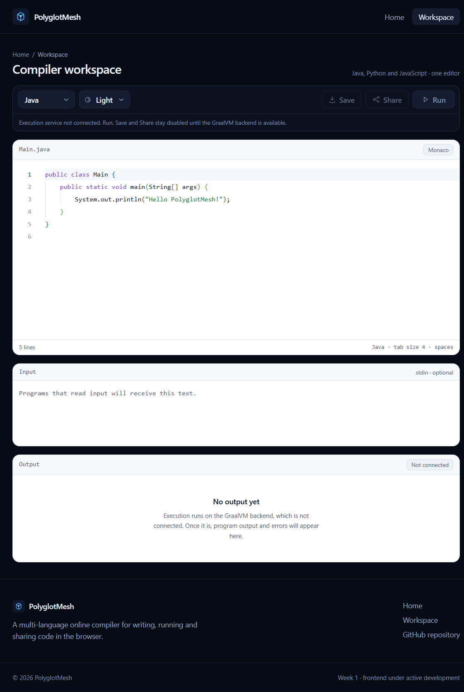

# PolyglotMesh

A multi-language online compiler platform for writing, running and sharing code directly in the browser.

PolyglotMesh is built on **Java 21 + GraalVM** and uses the **GraalVM Polyglot API** to execute multiple
languages inside a single JVM process — no external execution service, container runtime or third-party
judge is involved.

> **Project status:** Week 3 — backend hardening in progress (Days 15–17).
> The REST backend executes Java, Python and JavaScript for real, reports available languages,
> enforces rate/concurrency limits, validates and size-limits requests, bounds setup, execution,
> compilation and Java run time separately, and returns separate stdout/stderr with a status
> classification and compiler diagnostics. The frontend is not wired to the backend yet;
> execution is currently available through the REST API. The other six editor languages remain
> editor-only.

---

## Planned Features

- Multi-language code editor (Java, Python, JavaScript, Ruby, C, C++, Rust, Go, R)
- Language-aware starter code and syntax highlighting
- Program input (stdin) and output panels
- Save and share code snippets
- Light and dark editor themes
- Account authentication with JWT
- Execution powered by the GraalVM Polyglot API (Java, Python and JavaScript first; the other
  six editor modes are not executable until their runtime integrations land)

## Technology Stack

| Layer | Technology |
|---|---|
| Primary language | Java 21 |
| Multi-language runtime | GraalVM for JDK 21 |
| Polyglot integration | GraalVM Polyglot API |
| Build tool | Maven |
| Backend framework | Spring Boot |
| Authentication | Spring Security + JWT |
| Database | MySQL |
| Frontend | React.js + TypeScript |
| Frontend build tool | Vite |
| UI styling | Tailwind CSS |
| Code editor | Monaco Editor |
| API style | REST |
| API testing | Postman |

Authentication, JWT, MySQL persistence, saving and sharing are part of the planned stack and are
**not implemented yet**. The current backend is stateless and has no database.

## Repository Structure

```
PolyglotMesh/
├── frontend/       React + TypeScript + Vite client
├── backend/        Spring Boot + Java 21 service
├── docs/           Project and setup documentation
├── screenshots/    Reference screenshots of the running application
├── README.md
└── .gitignore
```

## Getting Started

```bash
git clone https://github.com/sthtavarthi-maker/PolyglotMesh.git
cd PolyglotMesh
```

### Backend

Requires Java 21 and Maven 3.9+.

```bash
cd backend
mvn spring-boot:run      # http://localhost:8080
```

`mvn clean verify` runs the full test suite and builds the executable jar. See
[`backend/README.md`](backend/README.md) for the endpoints, configuration,
supported languages and known limitations.

### Frontend

Requires Node.js 20.19+ (verified with 25.7.0).

```bash
cd frontend
npm install
npm run dev      # http://localhost:5173
```

See [`frontend/README.md`](frontend/README.md) for all frontend scripts and the `src/` layout.

The verified local development environment (tool versions, known PATH issues, and how to re-check
everything) is documented in [`docs/DEVELOPMENT_SETUP.md`](docs/DEVELOPMENT_SETUP.md).

## Screenshots

| Landing page | Compiler workspace, Monaco (dark) | Compiler workspace, Monaco (light) |
|---|---|---|
|  |  |  |

## Development Roadmap

| Day | Scope |
|---|---|
| 1 | Project initialization and repository structure |
| 2 | Development environment verification |
| 3 | React + TypeScript application initialization |
| 4 | Tailwind CSS styling and routing |
| 5 | Landing page |
| 6 | Compiler workspace UI |
| 7 | Monaco Editor integration |
| 8 | Nine-language editor support (Java, Python, JavaScript, Ruby, C, C++, Rust, Go, R; editor-only for the six new modes) |
| 9 | Backend architecture and the unified execution API (still `501` until adapters land) |
| 10 | GraalVM integration and real JavaScript execution on GraalJS |
| 11 | Real Python execution on GraalPy |
| 12 | Real Java execution with the JDK compiler and an isolated child JVM |
| 13 | Language discovery (`GET /api/languages`), admission control, compile timeout and cleanup |
| 14 | Operational finalization: graceful shutdown, build metadata, final verification and documentation |
| 15 | Backend security hardening: body-size guard, strict JSON, sandbox assertions and security tests |
| 16 | Execution resource management: separate setup/execution/compile budgets, bounded sandbox pool and cleanup |
| 17 | Execution diagnostics: separate stdout/stderr, status classification, compiler diagnostics and safe errors |

Week 2 is complete for the backend. Week 3 hardens it. Java, Python and JavaScript execute;
Ruby, C, C++, Rust, Go and R remain editor-only and return an honest `501`. Further weekly plans
are added as the project progresses.

## License

No license has been chosen yet. All rights reserved until a license is added.
